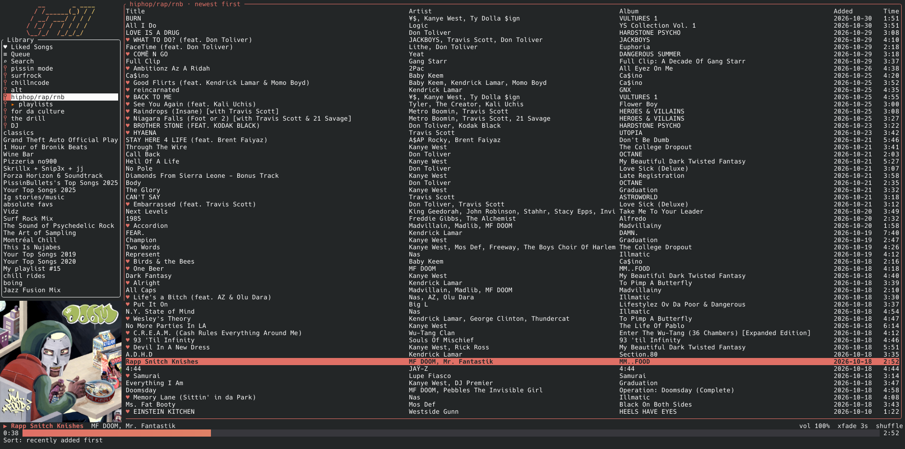

<p align="center">
  
</p>

<p align="center">
  <em>Spotify in your terminal. Lighter than the tab you'd open to look it up.</em>
</p>

<p align="center">
  
  
  
  
</p>

<p align="center">
  
</p>

<p align="center">
  <strong>~17 MB RAM &middot; 0% CPU idle &middot; ~2 ms key to frame &middot; ~30 ms launch to library</strong><br>
  <sub>With a 3,852-song Liked Songs open, on an i9-14900HX. Full numbers in <a href="#numbers">Numbers</a>.</sub>
</p>

---

trill is a terminal Spotify client that does one thing and does it cheaply. It plays through **Soloist**, Spotify's own headless player, so audio keeps working on the accounts where librespot gets refused. It browses through librespot's private connection, so no Web API limits apply to your library. One async thread does the UI and the networking. It redraws only when something changes, and it never polls.

## Features

- **Your library.** Playlists, Liked Songs, albums and artists. Pinned playlists and folders sit at the top, like in the official app.
- **Synced lyrics.** The current line lights up and stays in view, and the screen redraws exactly when the next line starts.
- **Real album art.** It uses kitty, Ghostty, WezTerm, foot, iTerm2 or Konsole graphics when the terminal has them, and colour half-blocks everywhere else.
- **10-band EQ** with 11 presets, as a PipeWire filter that only touches trill's audio. On Flat it doesn't run at all.
- **Spotify's own crossfade** and gapless transitions, streaming at 320 kbps.
- **Themes,** including `cover`, which takes its accent colour from the album art that's playing.
- **Edit as you listen.** Like and unlike, add to your playlists, remove from them. Every change is safe against edits made on your phone.
- **Desktop native.** MPRIS gives you the KDE media widget, the lock screen, media keys, `playerctl` and KDE Connect.
- **Remembers you.** Volume, EQ, crossfade, shuffle, repeat, sort order and theme come back on the next start.

## Numbers

Measured on an i9-14900HX laptop, with a network round trip to Spotify of about 150 ms.

| | |
|---|---|
| Launch to library on screen | ~30 ms (usable after login, ~0.35–0.6 s) |
| Open Liked Songs (3,852 tracks), first time | ~0.55 s; afterwards ~25 ms |
| Search | ~0.35 s |
| Key press to redraw | ~2 ms |
| Press play to playing | ~0.2 s |
| trill RAM at start (♥ set + cover loaded) | ~14 MB PSS |
| trill RAM, Liked Songs open | ~17 MB PSS |
| trill CPU while idle | 0 |
| trill CPU while playing | ~0.1–0.3% of one core (also with lyrics open) |
| Soloist while playing | ~2.5% of one core, ~48 MB (+ ~11 MB crash reporter) |
| EQ, when not on Flat | ~1.7% of one core, ~4 MB |

### Why it's light

- One async thread runs the UI and networking. librespot's player runtime is capped to one worker thread instead of one per CPU core.
- Terminal input sits on one blocking thread, so it uses no CPU while idle.
- The screen redraws only on input, player events, or once a second while playing. Nothing polls Spotify.
- Audio is decoded in-process and sent to PipeWire over the PulseAudio protocol. There's no rodio or cpal layer.
- Stream buffers go to `~/.cache/trill/tmp`, not `/tmp`. On CachyOS `/tmp` is tmpfs, which means RAM.
- Track info is fetched 300 tracks per request, with up to 16 requests in parallel, instead of one request per song.
- Each frame builds only the table rows that fit on screen.
- The playlist list is cached, so the sidebar fills on the first frame and refreshes in the background.
- Spotify login and Soloist startup run at the same time. With a saved login, the library is drawn from cache before the login finishes, and keys you type meanwhile wait their turn.
- Freed heap goes back to the OS after big lists load (`malloc_trim`), and glibc is limited to 2 malloc arenas.
- Album art is decoded and resized once per song, off the UI thread.

## Install

```bash
git clone https://github.com/junaydirfan/trill && cd trill
cargo build --release
install -Dm755 target/release/trill ~/.local/bin/trill
```

Build deps (already on CachyOS): `rust`, `libpulse`, `openssl`, `pkgconf`.

Optional: install the launcher so KDE shows trill's name and icon in the media widget (it also adds a menu entry).

```bash
install -Dm644 assets/trill.desktop ~/.local/share/applications/trill.desktop
```

If the `spotify-launcher` package is installed, you can set `Icon=` to `spotify-launcher` to get Spotify's icon.

### First run

```bash
trill
```

Your browser opens once for Spotify login, which is used to browse your library. librespot then stores reusable credentials in `~/.cache/trill/credentials.json`, so later starts skip the browser. `trill --logout` deletes them.

## Soloist setup (one time)

Since late 2025, Spotify has been refusing audio keys to librespot on more and more accounts ([librespot#1649](https://github.com/librespot-org/librespot/issues/1649)). On those accounts, login and browsing work, but every track fails with `error audio key 0 1` and is skipped. Soloist is Spotify's own player, so it isn't affected. trill starts it in the background, controls it over its local WebSocket, and manages shuffle, repeat and the queue itself.

1. **Get an API key** at https://developer.spotify.com/dashboard, under **Spotify Soloist API Key**. Save it so that only you can read it:
   ```bash
   install -Dm600 /dev/null ~/.config/trill/soloist_api_key && $EDITOR ~/.config/trill/soloist_api_key
   ```
2. **Install Soloist** from Spotify's CDN. Spotify's builds expire, so re-run this at least every 90 days:
   ```bash
   trill --update-soloist
   ```
3. **Pair once.** Run `trill --pair`, then pick **trill** in the device list of the Spotify app on your phone (on the same Wi-Fi).

trill uses Soloist automatically once the key and the binary are both in place. To force an engine, set `backend = soloist` or `backend = librespot` in the config.

> [!NOTE]
> Soloist only accepts the API key as a command-line argument. While it runs, anything that can list processes on this machine (`/proc/<pid>/cmdline`) can see the key. That's fine on a single-user desktop, but keep it in mind on a shared machine.

<details>
<summary><strong>How song transitions work</strong></summary>

When a song ends, Soloist would normally play its own autoplay "radio" pick. To prevent that, trill puts your next song into Soloist's queue about 8 s before the end, so the switch is native and gapless. Soloist's queue can't be edited. If you pick a different song during those last 8 s, the queued song is skipped first, and you may hear a split second of it (about 0.15 s).
</details>

## Keys

| key | action | | key | action |
|---|---|---|---|---|
| `↑↓` `jk` `PgUp/PgDn` `g/G` | move | | `f` | like / unlike |
| `Tab` `h` `l` | switch pane | | `A` | add to a playlist (type to filter) |
| `Enter` | play / open | | `D` `D` | remove from the open playlist |
| `Esc` `Backspace` | back | | `L` | lyrics |
| `Space` | play / pause | | `i` | album art on / off |
| `n` / `p` | next / previous | | `t` | next colour theme |
| `←→` or `,` `.` | seek ±10 s | | `s` / `r` | shuffle / repeat (off → all → one) |
| `+` / `-` | volume ±5% | | `o` / `O` | next / previous sort order |
| `a` | add to queue | | `e` / `E` | next EQ preset / EQ panel |
| `c` | show the queue | | `x` | crossfade off / 3 / 5 / 8 / 12 s |
| `/` | search | | `R` | reload the current list |
| `?` | key help | | `q` | quit |

## Details

<details>
<summary><strong>Library, sorting and pins</strong></summary>

- **Sorting:** playlists and Liked Songs show **most recently added first**, with an **Added** column, so playing from the top plays your newest additions first. `o` steps through the other orders: the playlist's own order, title, artist, album and length (`O` steps back). The list's header shows the current order, and it's remembered. Albums and artists always keep their track order.
- **Pins:** playlists and folders you pinned in Spotify sit at the top of the library, newest pin first. Opening a pinned folder lists its playlists. trill can't pin or unpin, because Spotify ignores pin changes from third-party clients, so pin them from the official app.
- **Liking:** `f` likes or unlikes the highlighted song, or the one playing. Liked songs show a ♥ everywhere, including the now-playing line. The ♥ changes straight away and changes back if Spotify refuses.
- **Playlists:** `A` opens a picker of the playlists you can edit, which are yours and collaborative ones. It warns before adding a song that's already there. In one of your playlists, pressing `D` twice removes the highlighted song. trill re-reads the playlist from Spotify first, so an edit made on your phone in the meantime can't make it remove the wrong song.

These actions go through the same private Spotify API as the rest of trill (not the Web API), so no rate limits apply. Each one takes about 0.4–0.5 s to reach Spotify.
</details>

<details>
<summary><strong>Lyrics and album art</strong></summary>

- **Lyrics:** `L` swaps the track list for the current song's lyrics. When Spotify has timed lyrics, the current line is highlighted and kept in view. Otherwise, `j`/`k` scroll. Lyrics are only fetched while this view is open.
- **Album art:** the cover sits under the playlist list when the window is tall enough. Terminals with an image protocol show a real image. kitty, Ghostty, WezTerm, foot and iTerm2 are detected automatically, and Konsole uses the iTerm2 protocol. Everywhere else, including Alacritty, tmux and VS Code, the cover is drawn with coloured half-block characters. For a sharp image in VS Code, turn on `terminal.integrated.enableImages`.
</details>

<details>
<summary><strong>EQ, crossfade, quality and themes</strong></summary>

- **EQ:** `e` cycles through the presets: Flat, Bass Boost, Bass Reducer, Treble Boost, Vocal, Rock, Pop, Hip-Hop, Electronic, Acoustic, Loudness and Custom. `E` opens the 10-band panel (32 Hz to 16 kHz, ±12 dB). In the panel, `↑↓` picks a band, `←→` adjusts it and `0` resets it. A preamp is set automatically so boosts don't clip.
  - The EQ is a small PipeWire filter that only trill's audio passes through, so other apps aren't affected.
  - **On Flat it doesn't run at all.** The first non-flat setting starts it and briefly restarts the player (~3 s, then it resumes where you were). After that, changes apply live. Set `eq = off` in the config to disable it completely.
- **Crossfade:** `x` cycles through off, 3, 5, 8 and 12 s. This is Spotify's own crossfade inside Soloist. Applying it restarts Soloist (~3 s, then it resumes where you were).
- **Quality:** trill sets Soloist to 320 kbps. Out of the box, Soloist streams at 160 kbps.
- **Themes:** `t` cycles through spotify, ocean, violet, sunset, rose, mono and cover. `cover` takes the accent colour from the album art of the song that's playing:
  - Every pixel votes for its colour, weighted by how colourful it is, so a vivid title or detail wins over a large muted area.
  - Pastel and off-white covers keep their tint, and black-and-white covers get a light grey.
  - The colour is brightened until it reads on a dark terminal. The last colour is remembered, so the next start opens in it.
  - The colour comes from the cover trill already decodes for the art (~0.5–1 ms per song). With the art hidden, trill fetches the cover just for its colour (~50–100 KB per song).
  - `trill --debug-tint <search>` prints the colour picked for each result's cover.

All of these, plus shuffle, repeat, sort order and album art on or off, are saved in `~/.local/share/trill/audio_settings`. Volume is saved too, including changes made from KDE's media controls or your phone.
</details>

<details>
<summary><strong>Config</strong></summary>

The config is optional. It lives in `~/.config/trill/config`:

```ini
bitrate = 320          # 96 | 160 | 320
audio_cache_mb = 0     # >0 keeps played tracks on disk (saves bandwidth on repeats)
normalise = false
client_id =            # your own Spotify app, used ONLY for search (see below)
backend = auto         # auto | soloist | librespot
device_name = trill  # how Soloist shows up in Spotify Connect
soloist_cache_mb = 200
soloist_ws =           # host:port of a Soloist you already run, instead of spawning one
eq = on                # off = never run the EQ process
art = on               # off = no album art (and no terminal capability query)
```
</details>

<details>
<summary><strong>Better search (recommended)</strong></summary>

Playlists, liked songs, albums and artists all use librespot's own connection, so the public Web API's limits don't apply to them. Search, however, uses the Web API.

Without your own app, search borrows librespot's shared token, which every librespot app uses, so Spotify rate-limits it most of the time. To keep search fast either way, trill always runs a tracks-only search alongside the Web API one (about 0.3 s), and after one rate-limit error it stops asking the Web API for 2 minutes.

For reliable full search (tracks, albums, playlists and artists):

1. Go to https://developer.spotify.com/dashboard, click **Create app**, and choose Web API.
2. Add the redirect URI `http://127.0.0.1:8898/login`.
3. Put the Client ID in the config as `client_id = …`. On the next start, trill asks you to log in once more, for search only.

The status line shows which search path answered: `web api` (your app), `web api*` (the shared token), or "tracks only" (the fallback).
</details>

<details>
<summary><strong>Debugging</strong></summary>

```bash
TRILL_LOG=debug trill              # writes ~/.cache/trill/trill.log
trill --debug-play [spotify:track:…] # play one track headless, print engine events
```

Soloist's own output goes to `~/.cache/trill/soloist.log`.
</details>

## FAQ

**Why not just librespot?**
On many accounts, Spotify no longer hands librespot the keys to decrypt audio. trill still uses librespot for everything except playback, and you can switch to it with `backend = librespot` if your account still works with it.

**Does it work without Premium?**
No. Both Soloist and librespot need a Premium account.

**Only CachyOS?**
No. It's tuned and tested there, but any Linux with PipeWire or PulseAudio works.

**Why does it ask me to log in twice?**
It only does if you set your own `client_id`. That second login is for search alone.
