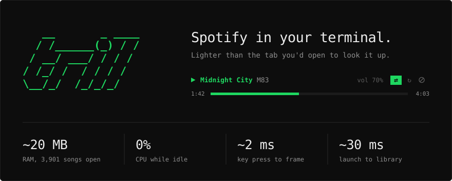
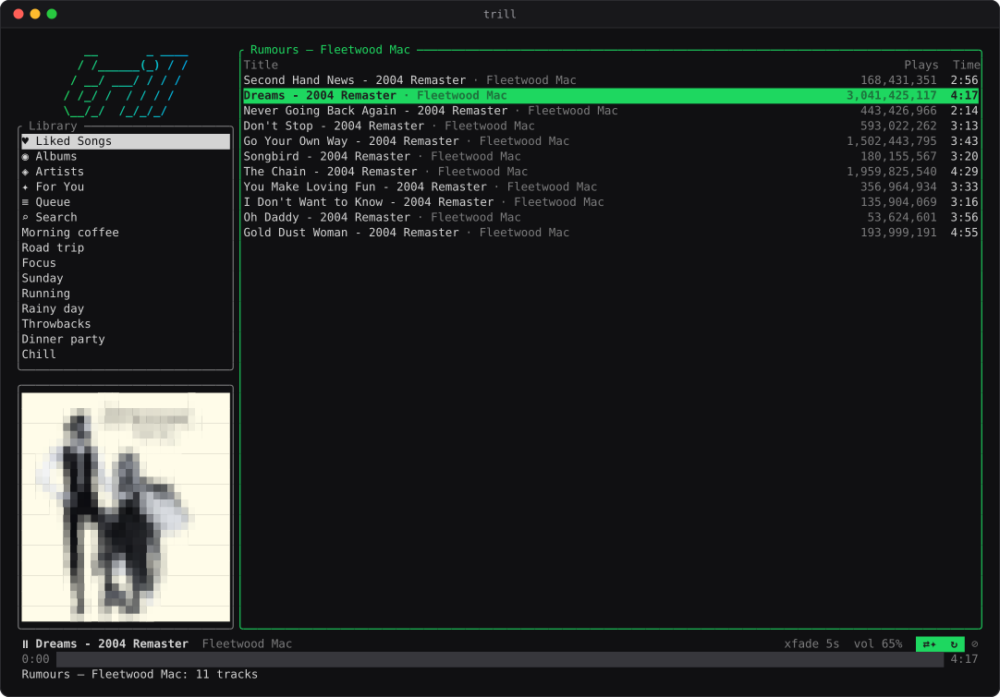
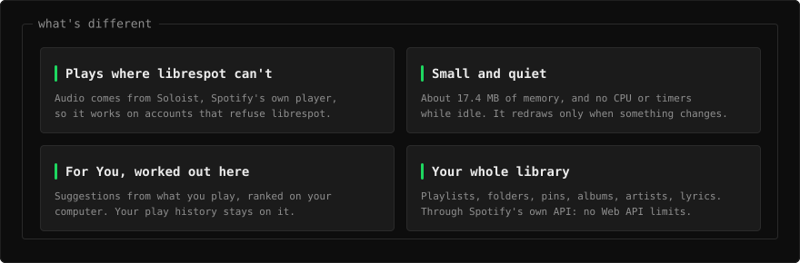
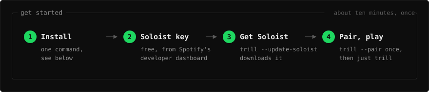
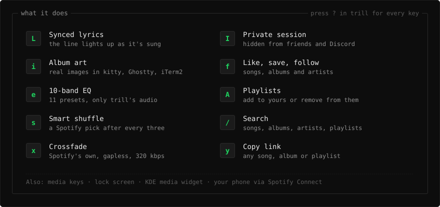
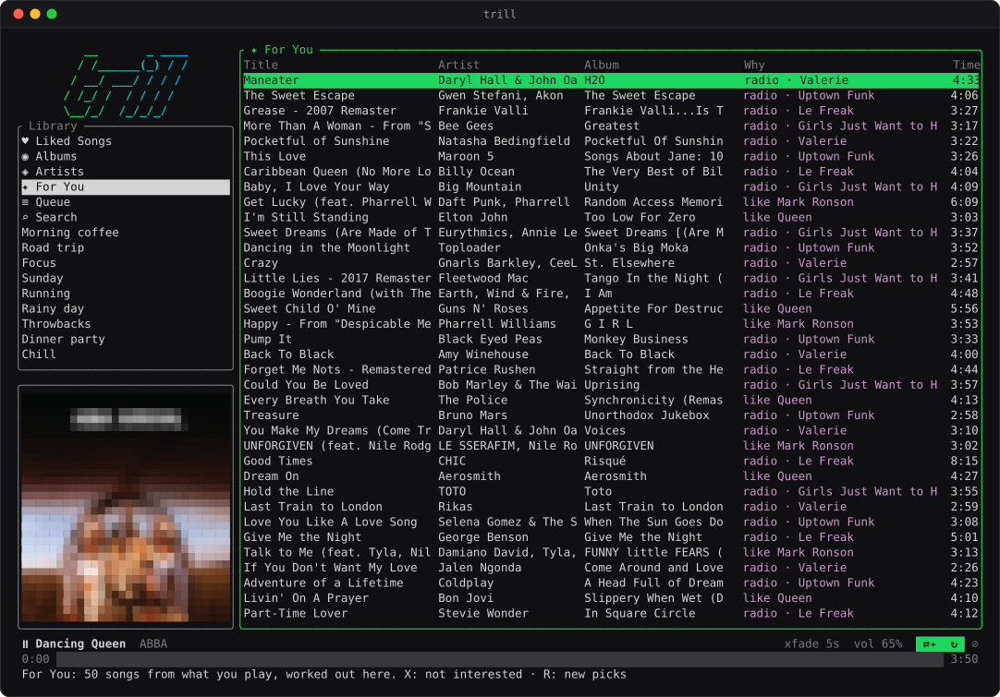
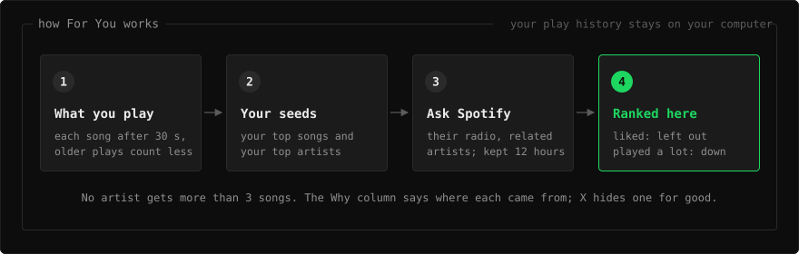
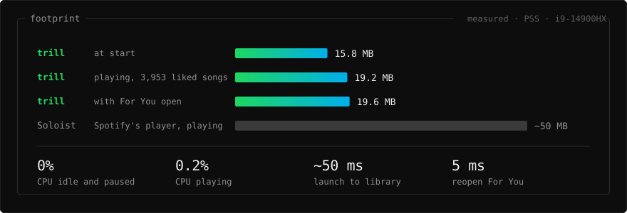
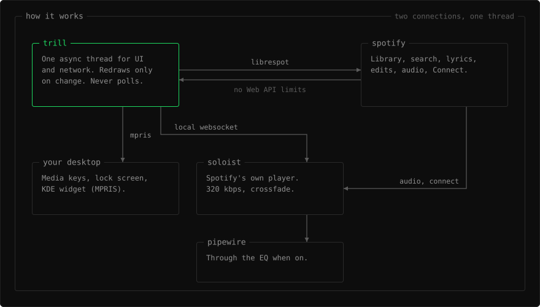
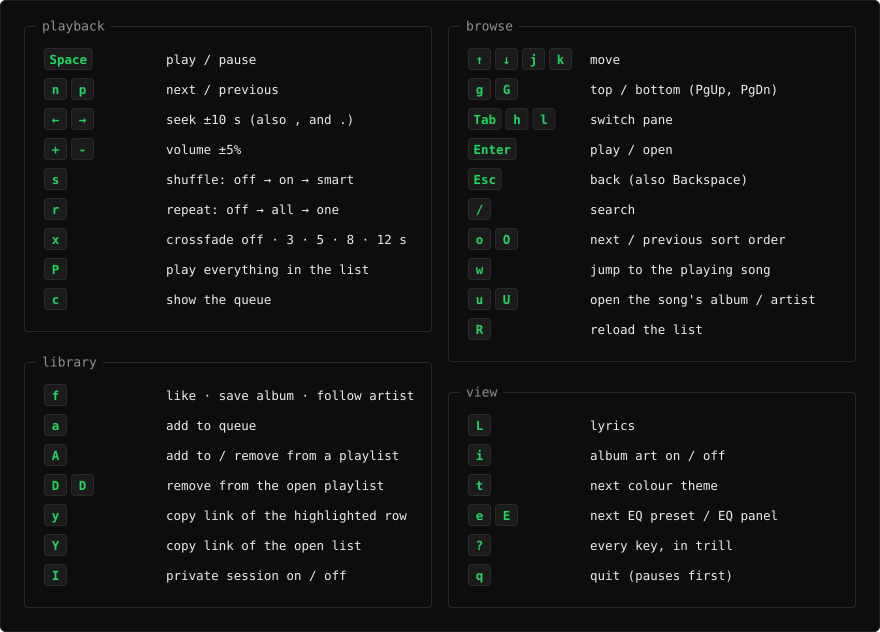

<p align="center">
  
</p>

<p align="center">
  <a href="https://github.com/junaydirfan/trill/releases/latest"></a>
  
  
  
  
  
</p>

<p align="center">
  
</p>

<p align="center">
  <a href="#get-started"><strong>Get started</strong></a> &nbsp;·&nbsp;
  <a href="#features"><strong>Features</strong></a> &nbsp;·&nbsp;
  <a href="#for-you"><strong>For You</strong></a> &nbsp;·&nbsp;
  <a href="#numbers"><strong>Numbers</strong></a> &nbsp;·&nbsp;
  <a href="#keys"><strong>Keys</strong></a> &nbsp;·&nbsp;
  <a href="#faq"><strong>FAQ</strong></a>
</p>

trill is Spotify for the terminal. Audio comes from **Soloist**, Spotify's own headless player, so it plays on accounts where librespot gets refused. Your library comes through librespot's connection, the same private API the official apps use, so the Web API's limits don't get in the way. It stays out of your way too: a small program that sleeps when there's nothing to do.

<p align="center">
  
</p>

## Get started

<p align="center">
  
</p>

You need **Spotify Premium**. Each step happens once.

**1. Install trill**

**Linux** (x86_64; needs `libpulse`, which comes with PipeWire and PulseAudio):

```bash
mkdir -p ~/.local/bin && curl -fsSL https://github.com/junaydirfan/trill/releases/latest/download/trill-linux-x86_64.tar.gz | tar -xz -C ~/.local/bin
```

**macOS** (Apple Silicon), then open a new Terminal window:

```bash
mkdir -p ~/.local/bin && curl -fsSL https://github.com/junaydirfan/trill/releases/latest/download/trill-macos-arm64.tar.gz | tar -xz -C ~/.local/bin
echo 'export PATH="$HOME/.local/bin:$PATH"' >> ~/.zshrc
```

**Windows** (PowerShell), then close PowerShell and open a new window:

```powershell
$dir = "$HOME\.local\bin"; New-Item -ItemType Directory -Force $dir | Out-Null
Invoke-WebRequest https://github.com/junaydirfan/trill/releases/latest/download/trill-windows-x86_64.zip -OutFile "$env:TEMP\trill.zip"
Expand-Archive -Force "$env:TEMP\trill.zip" $dir
[Environment]::SetEnvironmentVariable("Path", [Environment]::GetEnvironmentVariable("Path", "User") + ";$dir", "User")
```

**2. Get a Soloist key.** Sign in at https://developer.spotify.com/dashboard with your Premium account, open the **Soloist API Key** page and create a key (it starts with `spak_`). It belongs to your account, so keep it private like a password.

**3. Save it where trill looks for it**, then download Soloist:

```bash
mkdir -p ~/.config/trill && touch ~/.config/trill/soloist_api_key && chmod 600 ~/.config/trill/soloist_api_key
${EDITOR:-nano} ~/.config/trill/soloist_api_key      # paste the key, save
trill --update-soloist
```

On Windows: `New-Item -Force -ItemType File $HOME\.config\trill\soloist_api_key; notepad $HOME\.config\trill\soloist_api_key`, paste, save, then `trill --update-soloist`.

**4. Pair and play.** Run `trill --pair`, open Spotify on your phone (same Wi-Fi), tap the devices icon and pick **trill**. Then run **`trill`**. Your browser opens once to log in; after that it starts straight away. Press `?` for every key.

**Updating:** `trill --update` gets the latest release; your login, key, pairing and settings stay. trill also mentions a new release at the bottom right, once a day at most. Spotify's Soloist builds last 90 days: when trill says yours has expired, run `trill --update-soloist` again.

<details>
<summary><strong>If something doesn't work</strong></summary>

- **"trill is not recognized" / "command not found":** open a new terminal window after installing. On Linux with fish, run `fish_add_path ~/.local/bin` once.
- **Every song is skipped with "Unavailable":** trill isn't playing through Soloist, and the message says what's missing. Usually the key isn't in `~/.config/trill/soloist_api_key` (on Windows, `C:\Users\<you>\.config\trill\soloist_api_key`; a key saved as `soloist_api_key.txt` works too), or `trill --update-soloist` hasn't been run.
- **"Soloist isn't signed in":** run `trill --pair` again with your phone on the same Wi-Fi, and allow the firewall or local network prompt on Windows and macOS.
- **"Can't reach Spotify":** trill is offline. Your saved login is kept, so just start it again once you're connected.
- **Album art looks pixelated:** the terminal can't show images, so trill draws the cover with coloured blocks. That's always the case in Apple's Terminal, Alacritty, tmux and the old Windows console. Ghostty, kitty, WezTerm, foot, iTerm2, Konsole and Windows Terminal show the real cover.
- **`trill --update` can't replace the file** (say a package manager installed it): quit trill and run the install command from step 1 again. On Windows the file is locked while trill runs.
- **Anything else:** run `TRILL_LOG=debug trill` (Windows: `$env:TRILL_LOG="debug"; trill`). trill's log is then `~/.cache/trill/trill.log`, Soloist's is `~/.cache/trill/soloist.log`. An issue with the log helps.

Setting trill up on a second computer? Copy only `~/.config/trill/soloist_api_key` and pair there. Don't copy `~/.local/share/trill/soloist-data`: it's this computer's Soloist identity, and two players sharing one keep taking playback from each other.
</details>

<details>
<summary><strong>Build from source</strong></summary>

You only need Rust for this; the downloads above don't.

- **Linux:** needs `rust`, `libpulse`, `openssl` and `pkgconf` (all already on CachyOS).
  ```bash
  git clone https://github.com/junaydirfan/trill && cd trill
  cargo build --release
  install -Dm755 target/release/trill ~/.local/bin/trill
  install -Dm644 assets/trill.desktop ~/.local/share/applications/trill.desktop   # optional: name and icon in KDE's media widget
  ```
- **macOS:** `xcode-select --install`, Rust from https://rustup.rs, then `cargo install --git https://github.com/junaydirfan/trill`.
- **Windows:** Rust from https://rustup.rs (its installer sets up the C++ build tools), a new window, then `cargo install --git https://github.com/junaydirfan/trill`.

To update a build: `cargo install --git https://github.com/junaydirfan/trill --force`, or `git pull` and build again.
</details>

## Features

<p align="center">
  
</p>

<details>
<summary><strong>Every feature in a line</strong></summary>

- **Your library:** playlists, folders, Liked Songs, saved albums and followed artists, with your pins at the top like in the official app.
- **Artist pages:** top songs, then every album, single and EP, newest first. Albums and top songs show their all-time play counts. `P` plays the whole discography.
- **For You:** songs picked from what you play, worked out on your computer. See [For You](#for-you).
- **Smart shuffle** (`s` twice): a song Spotify recommends (✦) after every three of yours.
- **Synced lyrics** (`L`): the line being sung lights up and stays in view.
- **Album art** (`i`): real images where the terminal can, colour blocks elsewhere.
- **10-band EQ** (`e`, `E`, Linux): 11 presets, as a PipeWire filter only trill's audio goes through. On Flat it doesn't run at all.
- **Crossfade** (`x`): Spotify's own, gapless, streaming at 320 kbps.
- **Sleep timer** (`z`): 15 to 90 minutes or the end of the song. The volume fades out over 8 s, then it pauses.
- **Find in a list** (`F`): narrows the open list as you type, by title, artist or album.
- **Sort** (`o`): newest first, playlist order, title, artist, album or length. Each list remembers its own.
- **Search** (`/`): songs, albums, artists and playlists; `↑` brings back past searches.
- **Edit as you listen:** like, save and follow (`f`), add to and remove from playlists (`A`, ✓ shows where it already is), remove from the open playlist (`D D`). Safe against edits made on your phone meanwhile.
- **Queue** (`a`, `c`): songs you add play next; `D D` in the queue takes one out.
- **Private session** (`I`): Spotify's own, for your whole account. On Linux it also hides the song from Discord.
- **Desktop:** MPRIS on Linux (KDE's media widget, the lock screen, media keys, `playerctl`, KDE Connect), Now Playing on macOS, and your phone through Spotify Connect.
- **Themes** (`t`), including `cover`, which takes its colour from the album art. **The mouse** works too.
- **Remembers you:** volume, EQ, crossfade, shuffle, repeat, sorts, theme and searches come back next time.
</details>

## For You

<p align="center">
  
</p>

<p align="center">
  
</p>

**✦ For You** in the sidebar is 50 songs picked from what you actually play. The Why column says where each one came from. Press `X` on one you don't want and it won't come back (that works on ✦ smart-shuffle songs too). It opens at once from last time and is worked out again after 12 hours, or when you press `R`. Until you've played 15 different songs, your newest liked songs help it along.

<details>
<summary><strong>How it ranks, and what goes to Spotify</strong></summary>

- **What you play:** every song played for 30 s goes in `~/.local/share/trill/plays`. A play counts half as much every 14 days.
- **Seeds:** your 4 top songs, and the 4 artists of your top songs.
- **Candidates:** the radio of each seed song (what smart shuffle uses), and the top songs of the 12 artists Spotify most often lists as related to yours.
- **Ranking, on your computer:** songs from several sources add up. Liked songs and songs you said no to (`~/.local/share/trill/not_interested`) are left out. A song you played *n* times in the last 30 days counts 1/(1+*n*). Each further song by the same artist counts half (3 at most), and each further one from the same source 0.8, so the list stays varied.
- **What goes to Spotify,** over the same connection trill uses for browsing: the ids of your 4 seed songs (their radio), up to 40 of your top songs (to look up their artists), up to 16 artist ids (their pages) and the songs suggested (for titles and covers). About 20 requests, at most every 12 hours unless you press `R`. Your play log and your no's stay on your computer.
</details>

## Numbers

<p align="center">
  
</p>

<details>
<summary><strong>Every measurement</strong></summary>

Measured on the v0.6.0 release download on an i9-14900HX laptop (CachyOS), with the Soloist backend, a library of 3,953 liked songs and 110 playlists, and a network round trip to Spotify of about 150 ms. trill ran in tmux at 140×42 on a copy of a real config and cache. Memory is PSS from `/proc/<pid>/smaps_rollup`; wakeups are voluntary context switches over all of trill's threads.

| | |
|---|---|
| Launch to library on screen | ~50 ms (from disk; usable after login, ~0.45–0.55 s) |
| trill at start | 17.4 MB (peak 26 MB) |
| Liked Songs open and playing | 20.6 MB |
| After a few song changes | 19.9 MB (peak 30 MB) |
| For You open | 20.2 MB |
| CPU idle, and paused | 0 |
| Wakeups idle | ~3 a minute: Spotify's keepalive ping and its reply; paused, the same |
| CPU playing | ~0.2% of one core |
| Key press to frame | ~2.6 ms moving in 3,953 songs; ~5.6 ms re-sorting them; ~4.4 ms per key in find (timed inside trill with a timing build of this code) |
| For You, worked out | ~1.4–2.2 s; reopened from disk, 7 ms |
| Soloist while playing | ~49 MB, plus ~11 MB for its crash reporter; ~2% of one core |
| EQ, when not on Flat | ~4 MB, ~1.7% of one core (not re-measured for v0.6.0) |
| The program | 6.6 MB, nothing to install besides Soloist |

The release download links OpenSSL 3. On CachyOS and Arch that's a compatibility library nothing else uses, so about 1.3 MB of its memory counts against trill alone; built from source there, trill uses the system's OpenSSL and starts at about 15.8 MB.
</details>

<details>
<summary><strong>Why it's light</strong></summary>

- One async thread does the screen and the networking; keys are read on a thread of their own that sleeps until you type.
- The screen redraws only when something changes: a key, a player event, or once a second while playing. Lyrics redraw exactly when the next line starts.
- Nothing runs on a timer while idle. A dropped connection is noticed on your next key, not by polling.
- Every list you open is saved in `~/.cache/trill/lists`, so it opens at once, also after a restart, and a fresh copy loads in the background. Refreshing only fetches details for songs added since.
- Song details come 300 to a request, up to 16 requests at once. A request that fails leaves the saved list alone instead of shortening it.
- The first frame comes from disk while the login runs. A terminal that doesn't answer the image query (tmux, for one) is remembered, so later starts don't wait for it.
- On Linux, freed memory goes back to the system after big lists load and after each cover is decoded.
- Each frame builds only the rows that fit on screen.
</details>

## How it works

<p align="center">
  
</p>

**Why Soloist:** since late 2025, Spotify has been refusing audio keys to librespot on more and more accounts ([librespot#1649](https://github.com/librespot-org/librespot/issues/1649)): login and browsing work, but every song fails and is skipped. Soloist is Spotify's own player, so it isn't affected. trill starts it in the background, drives it over its local WebSocket, and keeps the queue, shuffle and repeat itself. With no Soloist key, trill plays through librespot instead; `backend = soloist` or `backend = librespot` in the config picks one.

> [!NOTE]
> Soloist only takes its API key on the command line, so while it runs, anything that can list processes on this computer can see the key. Fine on your own desktop; keep it in mind on a shared machine.

<details>
<summary><strong>How songs change over</strong></summary>

When a song ends, Soloist would play its own autoplay pick. To prevent that, trill puts your next song in Soloist's queue about 8 s before the end, so the change is gapless. Soloist's queue can't be edited, so if you pick another song in those last 8 s, the queued one is skipped first and you may hear a split second of it.
</details>

## Keys

<p align="center">
  
</p>

<details>
<summary><strong>Keys as text, and the mouse</strong></summary>

| key | action | | key | action |
|---|---|---|---|---|
| `↑↓` `jk` `PgUp/PgDn` `g/G` | move | | `f` | like a song · save an album · follow an artist |
| `Tab` `h` `l` | switch pane | | `A` | add to or remove from a playlist (✓ = already in it) |
| `Enter` | play / open | | `D` `D` | remove from the open playlist, or from the queue |
| `Esc` `Backspace` | back (clears a find first) | | `X` | not interested (For You, ✦ songs) |
| `Space` | play / pause | | `s` | shuffle ⇄: off → on → smart ⇄✦ |
| `n` / `p` | next / previous | | `r` | repeat ↻: off → all → one ↻1 |
| `←→` or `,` `.` | seek ±10 s | | `x` | crossfade off / 3 / 5 / 8 / 12 s |
| `+` / `-` | volume ±5% | | `z` | sleep timer: 15 / 30 / 45 / 60 / 90 min, end of song, off |
| `a` | add to queue | | `/` | search (`↑↓` past searches) |
| `c` | show the queue | | `F` | find in this list |
| `w` | jump to the playing song | | `o` / `O` | sort this list: next / previous order |
| `P` | play everything in the list | | `u` / `U` | open the song's album / artist |
| `L` | lyrics | | `R` | reload the list (For You: new picks) |
| `i` | album art on / off | | `e` / `E` | next EQ preset / EQ panel |
| `t` | next colour theme | | `I` | private session ⊘ on / off |
| `y` / `Y` | copy the link of the highlighted item / the open list | | `?` | every key |
| `q` `Ctrl-C` | quit (pauses first, so Spotify and Discord stop showing the song) | | | |

**Mouse:** click a sidebar entry to open it, a song to select it, double-click to play, click the progress bar to seek, and scroll the pane under the pointer. Click ⇄, ↻ or ⊘ to toggle them. In the playlist picker and the EQ panel, click to pick; a click outside closes them. To select text, hold `Shift` while dragging (`Option` in iTerm2, `Fn` in Apple's Terminal), or set `mouse = off`.
</details>

## Details

<details>
<summary><strong>Library, sorting and pins</strong></summary>

- **Sorting:** playlists and Liked Songs start **newest first**, with an Added column. `o` steps through the playlist's own order, title, artist, album and length (`O` steps back), and each list remembers its own. Albums and artist pages keep Spotify's order.
- **Find** (`F`): type to narrow the open list; `↑↓` move in it, `Enter` keeps it, `Esc` clears it. Playing from a narrowed list plays what's shown.
- **Pins:** playlists and folders you pinned in Spotify sit at the top, in the official app's order. trill can't pin or unpin (Spotify ignores pin changes from other clients), so pin them in the official app.
- **Smart shuffle:** `s` steps through off, shuffle and smart shuffle. Recommendations (✦) come from the list's Spotify radio, or the playing song's for Liked Songs and search. To keep one, press `w`: it shows at the top of the queue, where `f` likes it and `A` adds it (the picker starts on the list it was picked for). `X` says no to it.
- **Album and artist of a song:** `u` / `U` open them for the highlighted song, or the one playing.
- **Play all:** `P` plays every song in the open list, opening the albums and playlists in it. On an artist page that's the whole discography.
- **Playlists:** `A` opens a picker of the playlists you can edit (yours and collaborative ones). `Enter` adds the song, or removes it from a ✓ playlist, and the picker stays open until `Esc`. trill re-reads a playlist before removing, so an edit made on your phone meanwhile can't make it remove the wrong song.

These go through the same private API as the rest of trill, so no rate limits apply; each takes about 0.4–0.5 s to reach Spotify.
</details>

<details>
<summary><strong>Lyrics, album art, EQ, crossfade and themes</strong></summary>

- **Lyrics:** `L` swaps the list for the song's lyrics. With timed lyrics the current line is highlighted; otherwise `j`/`k` scroll. They're only fetched while this view is open.
- **Album art:** the cover sits under the sidebar when there's room. kitty, Ghostty, WezTerm, foot and iTerm2 are detected, and Konsole uses the iTerm2 protocol. Elsewhere, including Alacritty, tmux and VS Code (unless `terminal.integrated.enableImages` is on), it's coloured half-blocks.
- **EQ** (Linux): `e` cycles Flat, Bass Boost, Bass Reducer, Treble Boost, Vocal, Rock, Pop, Hip-Hop, Electronic, Acoustic, Loudness and Custom. `E` opens the 10-band panel (32 Hz–16 kHz, ±12 dB; `↑↓` band, `←→` adjust, `0` reset). It's a small PipeWire filter only trill's audio goes through. On Flat it doesn't run; the first other setting starts it and restarts the player once (~3 s, resuming where you were). `eq = off` disables it.
- **Crossfade:** `x` cycles off, 3, 5, 8 and 12 s. It's Soloist's own; applying it restarts Soloist once (~3 s, resuming).
- **Quality:** trill sets Soloist to 320 kbps (it defaults to 160).
- **Themes:** `t` cycles spotify, ocean, violet, sunset, rose, mono and cover. `cover` takes its colour from the album art, made readable on a dark terminal.

These and the rest of your keyboard settings are saved in `~/.local/share/trill/audio_settings`.
</details>

<details>
<summary><strong>Config</strong></summary>

Optional, in `~/.config/trill/config`:

```ini
bitrate = 320          # 96 | 160 | 320
audio_cache_mb = 0     # >0 keeps played songs on disk (librespot backend)
normalise = false
client_id =            # your own Spotify app, used only for search (below)
backend = auto         # auto | soloist | librespot
device_name = trill    # how Soloist shows up in Spotify Connect
soloist_cache_mb = 200
soloist_ws =           # host:port of a Soloist you already run, instead of starting one
eq = on                # off = don't run the EQ at all
art = on               # off = no album art (and no terminal query)
mouse = on             # off = no clicks or wheel; the terminal keeps its own selection
```
</details>

<details>
<summary><strong>Better search</strong></summary>

Search is the one thing that uses the public Web API. Without your own app it borrows librespot's shared token, which Spotify rate-limits most of the time, so trill always runs a basic search alongside it (about 0.3 s). The basic one finds songs and their albums and artists, but no playlists. After a rate-limit error trill pauses the Web API for 2 minutes, doubling up to 32.

For full search (songs, albums, playlists and artists) every time:

1. At https://developer.spotify.com/dashboard, **Create app** with the Web API.
2. Add the redirect URI `http://127.0.0.1:8898/login`.
3. Put its Client ID in the config as `client_id = …`. trill asks you to log in once more, for search only.

The status line says which one answered: `web api` (your app), `web api*` (the shared token) or "no playlists" (the basic search).
</details>

<details>
<summary><strong>Your data</strong></summary>

Everything trill keeps is plain text:

| | What |
|---|---|
| `~/.config/trill/` | `config`, `soloist_api_key` |
| `~/.local/share/trill/audio_settings` | your keyboard settings, sorts per list, past searches |
| `~/.local/share/trill/plays` | what you played, for For You (`time`, song, title, artist per line) |
| `~/.local/share/trill/not_interested` | songs you pressed `X` on |
| `~/.local/share/trill/soloist-data/` | this computer's Soloist pairing (don't copy it to another computer) |
| `~/.cache/trill/` | your login, lists, logs; safe to delete (you'd log in again) |

To take your history and settings to another computer, copy `audio_settings`, `plays` and `not_interested`. `trill --logout` forgets the login.
</details>

<details>
<summary><strong>macOS and Windows notes</strong></summary>

- **Which machines:** Apple Silicon Macs and x86_64 Windows, the Soloist builds Spotify publishes. ARM Windows runs the x86_64 build through emulation.
- **Same paths as Linux:** `~/.config/trill`, `~/.cache/trill` and `~/.local/share/trill` (on Windows, under `C:\Users\<you>`).
- **No EQ:** it's a PipeWire filter, and PipeWire is Linux-only.
- **Media keys:** on a Mac, play/pause, next and previous (keyboard, AirPods, Control Center, the lock screen) control trill, and Now Playing shows the song and cover. Windows has no media-key support yet; your phone can control trill through Spotify Connect.
- **Quitting:** `q` stops Soloist with trill. If trill crashes on a Mac or Windows, Soloist can keep running: `pkill soloist`, or `taskkill /IM soloist.exe /F`.
- The [Numbers](#numbers) were measured on Linux; the memory trimming only applies there. macOS and Windows builds are compiled and tested by CI on every release, but get less everyday use, so an issue helps if something seems off.
</details>

<details>
<summary><strong>Debugging</strong></summary>

```bash
TRILL_LOG=debug trill                 # writes ~/.cache/trill/trill.log
trill --debug-play [spotify:track:…]  # play one song headless, print the player's events
```

Soloist's own output goes to `~/.cache/trill/soloist.log`.
</details>

## FAQ

**Why not just librespot?**
On many accounts Spotify no longer gives librespot the keys to decrypt audio. trill still uses librespot for everything except playback, and `backend = librespot` switches to it if your account still works with it.

**Does it work without Premium?**
No. Soloist and librespot both need Premium.

**Only CachyOS?**
No. It's made and measured there, but any Linux with PipeWire or PulseAudio works, and so do Apple Silicon Macs and Windows PCs.

**Can I use it in WSL?**
The Linux build should work under WSL2 with WSLg for audio, but pairing your phone needs WSL's mirrored networking, so the native Windows build is easier.

**Why does it ask me to log in twice?**
Only if you set your own `client_id`: that second login is for search alone.

**Does For You send my listening history anywhere?**
No. The play log stays on your computer. Spotify sees the requests For You makes (radio and artist pages for a few seeds), the same kind trill makes while you browse. See [For You](#for-you).
